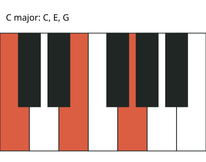

# Code examples

Four standalone components for audio software, physical controls and diagram rendering. They are educational implementations developed with AI assistance, separate from the private product code.

## SPSC queue

A UI thread may need to tell an audio thread that a setting changed. A **single-producer, single-consumer (SPSC) queue** gives one thread responsibility for adding messages and another responsibility for removing them.

[The queue](include/SpscQueue.h) reserves its storage in advance. `push` returns `false` when it is full, and `pop` returns `false` when it is empty. The caller must decide how to handle those cases. Release/acquire ordering ensures a message is written before the consumer treats it as available.

```cpp
SpscQueue<int, 8> commands;
// Producer thread
if (!commands.push(42)) { /* Handle a full queue. */ }

// Consumer thread
int command = 0;
if (commands.pop(command)) { /* Apply the received command. */ }
```

Tests check empty/full behavior, order, slot reuse and two-thread message integrity. The queue requires exactly one producer and one consumer; it is not a general-purpose queue for many writers.

## Parameter smoothing

An abrupt gain change can create an audible discontinuity. [The parameter ramp](include/SmoothedValue.h) moves a value toward a target over a chosen number of samples.

```cpp
SmoothedValue gain;
gain.reset(0.0f, 4);
gain.setTarget(1.0f);       // next() returns 0.25, 0.5, 0.75, then exactly 1.0.
```

A new target starts from the current value. Repeating the same target does not restart the ramp. This component is single-threaded and accepts finite numeric values; it does not provide the thread-to-thread messaging itself.

## Button debouncing

A physical switch can briefly alternate between open and closed as it is pressed. Treating every change as an action can produce repeated triggers.

[The debouncer](include/Debouncer.h) remembers a candidate state and accepts it only after it stays unchanged for a chosen interval. `update` returns `true` when the accepted state changes; `pressed` reads that accepted state. Tests cover bounce, release and the millisecond counter wrapping back to zero.

It uses one control task and an unsigned millisecond clock. Both the debounce interval and gaps between polls must be less than half the clock range. Encoder direction decoding is outside this component.

## Keyboard renderer

[The TypeScript renderer](diagram/render.ts) accepts a label and MIDI note numbers. In this example, 60 is middle C, 64 is E and 67 is G. It validates the list, highlights those keys and escapes label text before emitting SVG, a vector image format.



The renderer takes explicit pitches; chord-name interpretation belongs in a separate music-theory layer.

## Run the tests

Install Python 3, g++ and Node.js 24+, then run:

```sh
python3 check.py
```

Or run the C++ checks through CMake 3.16+:

```sh
cmake -S . -B build -DCMAKE_BUILD_TYPE=Release
cmake --build build
ctest --test-dir build --output-on-failure
```

To run only the renderer tests:

```sh
node --test diagram/render.test.mjs
```

GitHub Actions runs the CMake/CTest build, AddressSanitizer and UndefinedBehaviorSanitizer checks, and renderer tests. Sanitizers look for classes of memory and undefined-behavior errors; they do not establish real-time performance or prove the absence of races.

The renderer tests execute TypeScript using Node's native type stripping, not a compiler type check. These examples also do not replace device testing or full-product tests.
